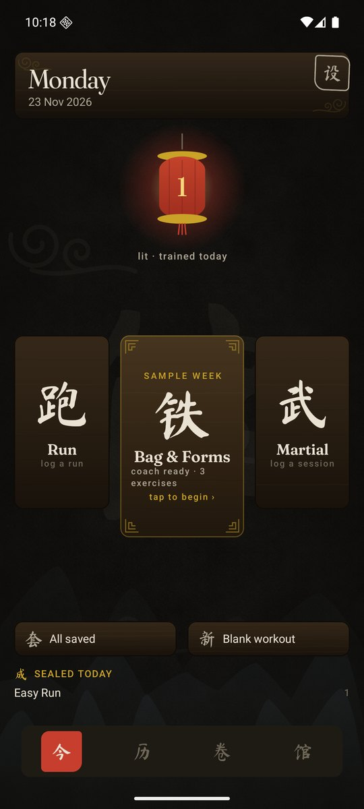
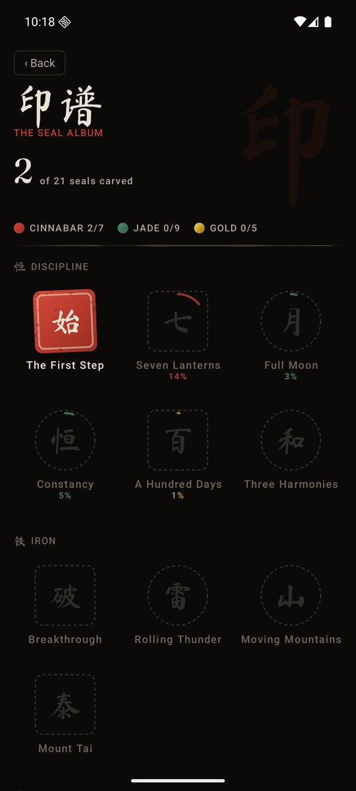
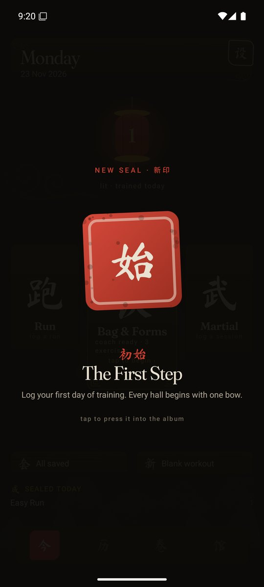
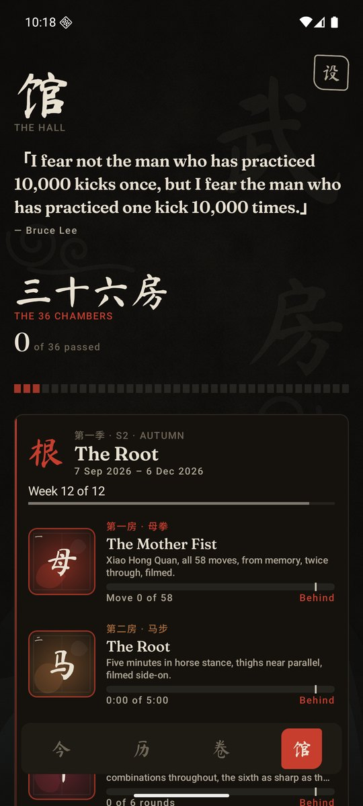
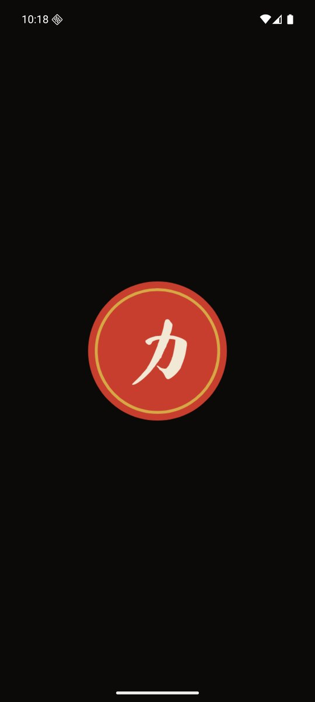
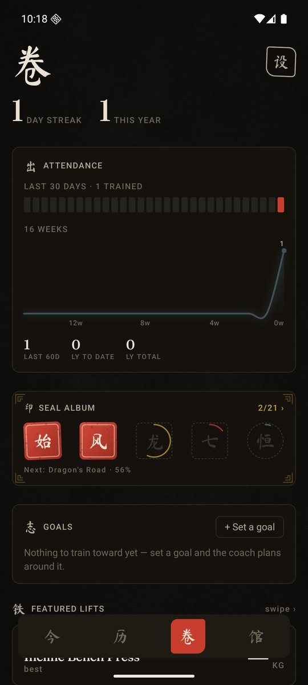
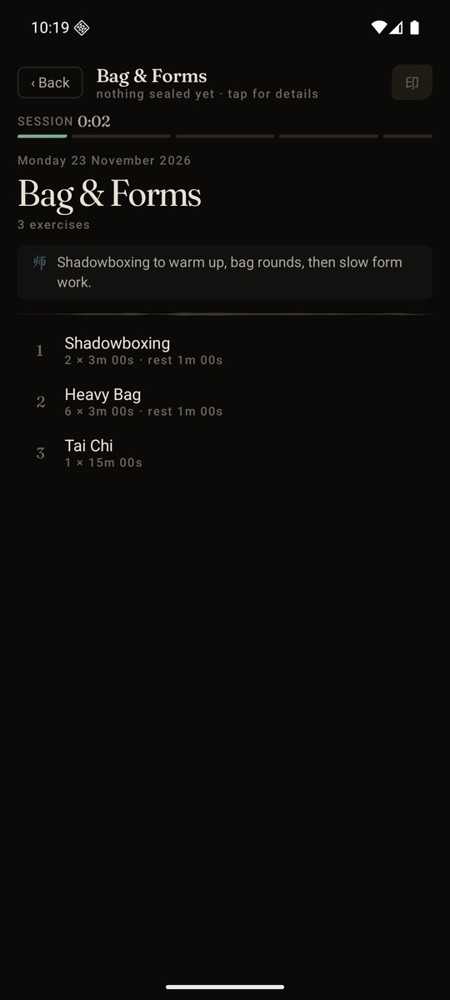

# Lìliàng 力量

**Lìliàng** (力量, "strength") is an Android workout tracker for people who lift *and* train a martial art. Gym sessions, runs, bag rounds and form practice share one log. A progression engine writes your next session from your history, a "hall" tracks traditional forms move by move, and a seal album turns milestones into carved achievement seals.

The look is ink on paper: an OLED-black page, bone-white type, vermillion seals and brush-calligraphy hanzi, framed with auspicious-cloud scrolls (祥云), key-fret borders (回纹) and an ink-wash mountain horizon (山水).

<p align="center">
  
  
  
  
</p>

⬇️ **[Download the APK](https://github.com/jammula-rithwik/liliang/releases/latest)** · 📘 **[The complete guide (PDF)](docs/Liliang-Guide.pdf)** covers every screen, the progression engine, the seals, backups, and building from source.

---

## Contents

- [Features](#features)
- [Screens at a glance](#screens-at-a-glance)
- [The seal album](#the-seal-album-印谱)
- [Install](#install)
- [Build from source](#build-from-source)
- [Run it in an emulator](#run-it-in-an-emulator)
- [Project layout](#project-layout)
- [Tech stack](#tech-stack)
- [Credits and licence](#credits-and-licence)

## Features

- **Today (今).** The active plan's workout for the day on a gilded centre tablet, one-tap logging for a run or a martial-arts session, and a streak lantern that forgives the odd planned rest day.
- **Gym sessions.**
  - Drag-to-adjust weight and reps dials, with last session's sets shown as pills.
  - Planned rest with a timer, supersets and per-side holds.
  - Per-exercise kg or lb plates (always stored in kg).
  - Spoken set notes through the phone's own speech recogniser.
- **Progression engine.** Estimated 1RM (Epley) trends, double progression for hypertrophy work, strength and power schemes, plateau waves, and deloads after repeated stalls. Every prescription comes with a plain-language reason.
- **Plans and templates.** Weekly or multi-week plans that paint the calendar, reusable workout templates, and an exercise library with roles and muscle groups.
- **Runs.** Distance, duration and pace, with weekly volume and a coach suggestion for the next run.
- **The Hall (馆).**
  - Forms as data: Chen Yi Lu, Yang 37, Wing Chun, Xiao Hong Quan, Taegeuk, qigong sets and sun salutations.
  - A move-name wheel for logging how far through a form you got.
  - Boxing, Muay Thai and taekwondo combo libraries, and a round timer that calls combos aloud.
- **The 36 Chambers (三十六房).** A three-year path of twelve seasons with three filmable feats each. Measurable feats show progress against the season's clock.
- **The seal album (印谱).** 21 achievement seals in cinnabar, jade and gold, earned from your real history. [More below.](#the-seal-album-印谱)
- **History (历 / 卷).** Calendar, day detail, an attendance heatmap, exercise records and charts, muscle balance, year rhythm and goals.
- **Your data stays on the phone.**
  - Everything is stored in a plain SQLite database, which you can export and import whole.
  - Optional automatic backups to a folder you choose.
  - An optional folder import that reads exercise, combo, form, workout and schedule definitions written as JSON.
  - The database is excluded from Android cloud backup.

## Screens at a glance

| Splash | Today | Scroll | Session |
|---|---|---|---|
|  |  |  |  |

The dock along the bottom holds the four rooms: **今** Today, **历** Calendar, **卷** Scroll (your training year), **馆** Hall. The **设** seal in the top-right corner opens Settings from any room.

## The seal album (印谱)

Achievements are carved seals, measured from history the app already keeps:

| Path | Seals |
|---|---|
| 恒 Discipline | 始 The First Step · 七 Seven Lanterns · 月 Full Moon · 恒 Constancy · 百 A Hundred Days · 和 Three Harmonies |
| 铁 Iron | 破 Breakthrough · 雷 Rolling Thunder · 山 Moving Mountains · 泰 Mount Tai |
| 路 Road | 风 Chasing the Wind · 龙 Dragon's Road · 里 A Thousand Li |
| 武 Martial | 武 On the Path · 拳 Iron Fist · 学 The Student · 形 The Form Complete · 宗 Keeper of the Lineage |
| 房 Chambers | 房 Through the Door · 季 A Season · 师 Master of the 36th |

- **Tiers:**
  - **Cinnabar seals** are square.
  - **Jade seals** are round.
  - **Gold seals** have a carved double border with cloud scrolls in the corners.
- **Earning one:** the seal stamps down full-screen with a burst of gold leaf. The stamp waits until a gym session or round timer is finished, so it never interrupts a set.
- **Earned seals stay earned,** even after the rolling window that earned them moves on.
- **Locked seals** appear as faint carved outlines, with a coloured arc tracing the border as you close in on them. Tap one for its story and progress.

## Install

Lìliàng runs on **Android 8.0 (API 26) and newer** and targets **Android 16 (API 36)**.

1. Download **`Liliang-R22.apk`** from the [latest release](https://github.com/jammula-rithwik/liliang/releases/latest), or build it yourself (see below).
2. Copy it to your phone and open it. Android will ask you to allow installs from that source.
3. Optional: if you used KUAN before, export its database in KUAN (Settings → Data & backup → Export database), then import it in Lìliàng (Settings → Data & backup → Choose file & import). The two apps install side by side; they do not share data automatically.

## Build from source

**Requirements:** JDK 17 or 21, and the Android SDK with platform 36 and build-tools. The Gradle wrapper fetches Gradle 8.14.3.

```sh
# point Gradle at your SDK (or set ANDROID_HOME)
echo "sdk.dir=/path/to/android-sdk" > local.properties    # Windows: sdk.dir=C\:/path/to/sdk

./gradlew assembleDebug          # -> app/build/outputs/apk/debug/Liliang-R<versionCode>.apk
./gradlew testDebugUnitTest      # JVM unit tests: engine, parsing, plans, chambers, seals
./gradlew lintDebug              # Android lint
adb install -r app/build/outputs/apk/debug/Liliang-R*.apk
```

`scripts/build-debug-apk.sh`, `scripts/run-tests.sh` and `scripts/install-debug-apk.sh` wrap the same commands.

A fresh install starts with:
- an empty log;
- the exercise and combo libraries;
- the forms catalogue;
- a sample week: Upper A, Bag & Forms, Lower A, Easy Run, Upper B, Kicks & Conditioning.

**Fonts and icon.** The fonts are committed already subset to the glyphs the app uses.
- `scripts/fetch-fonts.sh` re-downloads the OFL typefaces and re-subsets them.
- `scripts/gen-icon.py` traces the 力 glyph from Ma Shan Zheng into the adaptive launcher icon, the themed (monochrome) icon and the splash seal.

Both scripts need Python with `fonttools`.

> **Network note (Windows).** If the Gradle wrapper times out downloading from `services.gradle.org`, download `gradle-8.14.3-bin.zip` with a browser or `curl`, unzip it, and run that Gradle's `bin/gradle.bat` directly.

## Run it in an emulator

```sh
sdkmanager "emulator" "system-images;android-36;google_apis;x86_64"
avdmanager create avd -n Liliang_API36 -k "system-images;android-36;google_apis;x86_64" -d pixel_8
emulator -avd Liliang_API36
adb install -r app/build/outputs/apk/debug/Liliang-R*.apk
```

On Windows the emulator needs hardware acceleration. `emulator -accel-check` should report that WHPX is usable.

## Project layout

```
app/src/main/java/com/liliang/app/
├── MainActivity · LiliangApp (shell, dock, overlays, transitions) · LiliangViewModel · LiliangNav
├── data/      domain, repository (SQLite), formatting, parsing, martial arts, 36 Chambers, seals
├── engine/    WorkoutProgression (e1RM, plateau waves, deloads, goal test days)
├── platform/  TextToSpeech, haptics, voice notes
├── design/    ink theme, typography, paper grain, motion, components, charts,
│              motifs (cloud scrolls, key-fret, ink mountains, seal wear)
└── ui/        Today, Session, Calendar, Day detail, Scroll, Goals, Hall, Round timer,
               Library, Plans, Settings, Seal album
app/src/test/java/com/liliang/app/   JVM unit tests
docs/                                 the guide PDF and screenshots
scripts/                              build, test, install, font and icon tooling
```

## Tech stack

- **Kotlin 2.2** with the Compose compiler plugin, and **Jetpack Compose** (BOM 2025.09) with Material 3.
- A single activity with no navigation library: one `LiliangViewModel`, a tab enum and an overlay back stack.
- A raw `SQLiteOpenHelper` with idempotent, additive migrations and WAL journaling.
- **AGP 8.13**, compile and target SDK **36 (Android 16)**, min SDK 26.
- Android platform features:
  - edge-to-edge layout;
  - predictive back;
  - the Android 12+ splash screen (`core-splashscreen`);
  - a themed launcher icon.
- Platform TextToSpeech for combo call-outs and SpeechRecognizer for set notes.
- An AGSL paper-grain shader on Android 13+, with a bitmap fallback for older devices.
- **Fraunces** and **Ma Shan Zheng**, subset. Both are under the SIL Open Font License; the licence texts are in `app/src/main/assets/licenses/`.

## Credits and licence

Lìliàng is built on **[KUAN](LICENSE)** by Greg Gaynor (MIT). The rebrand, the Android 16 update, the seal album and the visual refresh build on that work.

Released under the MIT License, see [LICENSE](LICENSE). The bundled fonts keep their own SIL Open Font License.
